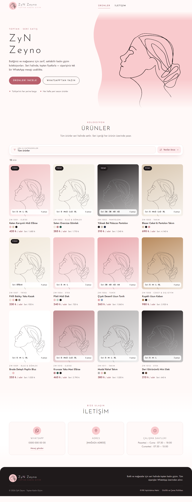
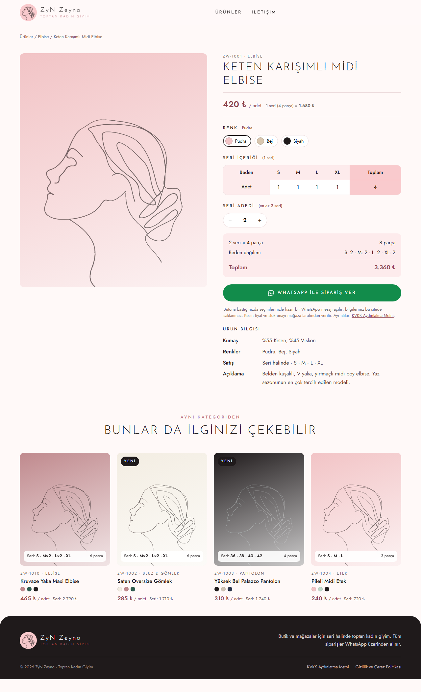

# ZyN Zeyno

[Türkçe](#türkçe) · [English](#english)

| Ana sayfa · Home page | Ürün sayfası · Product page |
|---|---|
|  |  |

---

## Türkçe

Toptan kadın giyim satan bir mağaza için katalog sitesi ve yerel yönetim paneli.

### Site (`ZyN Zeyno/`)

HTML, CSS ve JavaScript ile yazılmış statik bir site. Sunucu, veritabanı, üyelik veya ödeme yok; siparişler WhatsApp üzerinden alınır.

- **Seri satış:** Ürünler seri hâlinde satılır (ör. S-M-L-XL birer adet = 4 parça). Seri fiyatı adet fiyatından otomatik hesaplanır; her ürünün en az sipariş seri adedi vardır.
- **Ürün sayfası:** Görsel galerisi, renk ve seri adedi seçimi, toplam parça ve tutar. "WhatsApp ile Sipariş Ver" düzenli bir sipariş mesajı hazırlar.
- **Arama ve kategoriler:** Soldan açılan panelde arama, sayılı kategoriler ve sıralama.
- **Yasal ve teknik:** KVKK ve gizlilik sayfaları, 404 sayfası, `sitemap.xml`, `robots.txt`, uygulama ikonları, Open Graph ve JSON-LD.
- **Güvenlik:**
  - İçerik Güvenlik Politikası (CSP): yalnızca sitenin kendi kodları çalışır, dış bağlantı yapılamaz.
  - Tüm metinler sayfaya yazılmadan önce kaçışlanır (XSS koruması).
  - Çerez veya takip aracı yok.

### Yönetim paneli (`ZyN Zeyno Yönetim/`)

Node.js ile yalnızca o bilgisayarda çalışan bir panel (`127.0.0.1`); internete ve ağdaki diğer cihazlara kapalı.

- Ürün, kategori, iletişim ve mağaza ayarlarını düzenler; ürün fotoğraflarını küçültür; her kayıttan önce yedek alır.
- "Yayınla" önce siteyi kontrol eder, sonra Cloudflare Pages'e yükler.

### Çalıştırma

1. [Node.js](https://nodejs.org) (LTS) kurun.
2. `ZyN Zeyno Yönetim/Yonetim Paneli.bat` dosyasına çift tıklayın. Panel tarayıcıda açılır: `http://127.0.0.1:5199`.

Ayrıntılar: [Yönetim paneli belgesi](<ZyN Zeyno Yönetim/README.md>) · [Proje tanımı](<ZyN Zeyno Yönetim/PROMPT.md>)

> Bu depoda iletişim bilgileri (telefon, adres, e-posta, sosyal medya) yer almaz. Panelin “İletişim & Ayarlar” sekmesinden doldurulur.

---

## English

A catalogue site and a local admin panel for a shop that sells women's clothing wholesale.

### Site (`ZyN Zeyno/`)

A static site in HTML, CSS and JavaScript. No server, database, accounts or payments; orders are taken over WhatsApp.

- **Series sales:** Products are sold in series (e.g. one each of S-M-L-XL = 4 pieces). The series price is calculated from the unit price; every product has a minimum number of series.
- **Product page:** Image gallery, colour and series count, total pieces and amount. "Order on WhatsApp" prepares a tidy order message.
- **Search and categories:** A side panel with search, categories with counts, and sorting.
- **Legal and technical:** Privacy pages (Turkish KVKK), a 404 page, `sitemap.xml`, `robots.txt`, app icons, Open Graph and JSON-LD.
- **Security:**
  - Content Security Policy: only the site's own scripts run, and no outside connections are made.
  - Every text is escaped before it reaches the page (XSS protection).
  - No cookies or tracking.

### Admin panel (`ZyN Zeyno Yönetim/`)

A Node.js panel that runs only on that computer (`127.0.0.1`), closed to the internet and other devices on the network.

- Edits products, categories, contact details and shop settings; shrinks product photos; backs up before every save.
- "Publish" checks the site first, then uploads it to Cloudflare Pages.

### Running it

1. Install [Node.js](https://nodejs.org) (LTS).
2. Double-click `ZyN Zeyno Yönetim/Yonetim Paneli.bat`. The panel opens in the browser at `http://127.0.0.1:5199`.

The panel documentation (Turkish) is in [ZyN Zeyno Yönetim/README.md](<ZyN Zeyno Yönetim/README.md>).

> This repository contains no contact details (phone, address, email, social media); they are filled in from the panel's “İletişim & Ayarlar” tab.

---

Made by [Ahmet Şahin](https://github.com/alpha32k).
